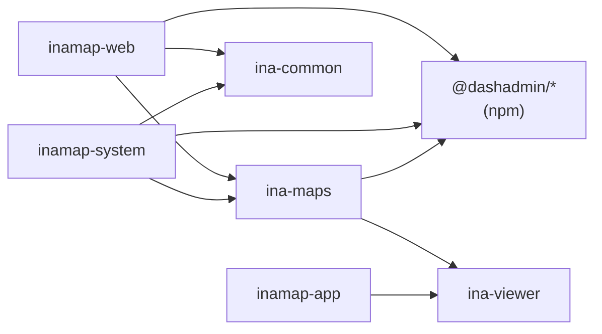

# INAMAP — frontend del dominio

Frontend de INAMAP sobre el framework **DashAdmin** (`@dashadmin/*`, publicado en npm). Es un
workspace pnpm aislado: se clona, se instala y funciona sin el monorepo de otros dominios.

```text
inamap-frontend-domain/
├── apps/
│   ├── inamap-web/      Panel de clientes (tenants): registro, inamaps, editor de mapas, categorías, usuarios, suscripción
│   ├── inamap-system/   Administración de plataforma: tenancies, tenants, planes, usuarios, pasarelas, inamaps
│   └── inamap-app/      Visor público (sin react-admin): búsqueda, rutas, ruta accesible, QR
├── packages/
│   ├── ina-maps/        Recursos DashAdmin (inamaps, categorías, reportes) y el editor de mapas
│   ├── ina-viewer/      Dibujo del mapa (SVG), geometría, cliente de la API pública y visor
│   └── ina-common/      Piezas de plataforma compartidas (providers, páginas de cuenta, imagen del tenant)
├── vite-plugins/        Plugins de Vite del framework (alias de paquetes locales en desarrollo)
└── pnpm-workspace.yaml  Versiones fijadas de @dashadmin/*, MUI, react-admin, etc.
```

## Requisitos

- Node.js ≥ 20.19 y pnpm 11 (`corepack enable`).
- El backend levantado con [`inamap-backend-docker`](../inamap-backend-docker/README.md)
  (API en `http://localhost:25200/api`).

## Primer arranque

```bash
pnpm install

# Variables de cada app (no van a git)
cp apps/inamap-web/.env.inamap-web.local.example apps/inamap-web/.env.inamap-web.local
cp apps/inamap-system/.env.inamap-system.local.example apps/inamap-system/.env.inamap-system.local
cp apps/inamap-app/.env.example apps/inamap-app/.env.local
# En los dos primeros, VITE_APP_SOCKETS_KEY = REVERB_APP_KEY de inamap-backend-docker/.env.app.local
```

| Comando | App | URL |
|---|---|---|
| `pnpm dev:web` | Panel de clientes | http://localhost:5181 |
| `pnpm dev:system` | Administración de plataforma | http://localhost:5182 |
| `pnpm dev:app` | Visor público | http://localhost:5180 |

Usuarios de prueba: los que crea el backend al sembrar (ver `.env.app.local` del docker).

## Comandos

```bash
pnpm test             # pruebas de geometría del visor (vitest)
pnpm typecheck        # tipos de los paquetes ina-* y de inamap-app
pnpm build:packages   # compila ina-* (necesario antes de un build de producción de las apps)
pnpm build            # paquetes + las tres apps
INAMAP_ENV=staging pnpm build:web   # usa apps/inamap-web/.env.inamap-web.staging
```

En desarrollo los paquetes `ina-*` se resuelven a su código fuente (`vite-plugins/localPackageSrcAliases.mts`):
no hace falta compilarlos para ver cambios.

## Arquitectura



- **Las apps DashAdmin** (`inamap-web`, `inamap-system`) siguen el mismo esqueleto que las demás
  apps del framework: `main.tsx` → `WebBootstrap` → app pública o privada → manifiesto de recursos
  (`resources/WebPrivateResources.tsx` a nivel tenancy y `WebTenantPrivateResources.tsx` a nivel
  tenant, para el TenantSwitcher).
- **`ina-maps`** ocupa el lugar del paquete de dominio: exporta `inamapResources` (inamaps y
  categorías) y `reportResources`, y registra su vocabulario (`ina_maps.*`) en el registro de
  traducciones en tiempo de ejecución al cargar su chunk.
- **`ina-viewer`** no depende de react-admin; lo usan el editor y el visor público.
- **`ina-common`** contiene lo que las apps reutilizan del framework de forma neutral: utilidades
  de los providers de autenticación y datos, `TenantImage`, paletas de color, páginas de registro,
  alta, éxito y legal, y el ícono del cargador.

### Contrato con `dash-admin`

Cada app DashAdmin **debe** proveer, porque el framework los importa con el alias `@app`:

| Módulo | Para qué |
|---|---|
| `src/DASHApp.tsx` | `AppAsyncWrapper` lo carga de forma diferida (app pública). |
| `src/assets/logo-horizontal.png`, `login-back.png` | Logo y fondo de las pantallas de cuenta (`FullLayoutMarkup`). |

## Editor de mapas

Se abre desde **Inamaps → (fila) → ver**: es la vista "show" del recurso, a pantalla completa.

| Zona de la pantalla | Contenido |
|---|---|
| Menú lateral de la app | Secciones **MAPA** (Información, Editor, Layouts, Configuración), **HERRAMIENTAS** (Seleccionar, Zona, Estructura, Ubicación, Camino, Enlace, Medir) y **CAPAS**, debajo de los recursos. |
| Barra superior | Inamap › piso, estado (Borrador/Publicado), cambios sin guardar, deshacer/rehacer, Vista (Edición / Vista previa), Guardar, Publicar. |
| Barra de herramienta | Acciones de la herramienta activa (añadir/eliminar vértice, cerrar polígono, color, opacidad) y una ayuda. |
| Lienzo | Plano del piso en metros con capas, ajuste a vértices y a la grilla, selector flotante de pisos. |
| Barra de estado | Zoom, coordenadas X/Y, grilla, snap, conectividad, probar ruta. |
| Drawers derechos | Propiedades del elemento seleccionado, Layouts, Información y Configuración. |

Atajos: `Ctrl/⌘+S` guardar · `Ctrl/⌘+Z` deshacer · `Ctrl/⌘+Shift+Z` rehacer · `Enter` cerrar
polígono o camino · `Esc` cancelar · `Supr` eliminar el elemento seleccionado · `Alt`+arrastrar o
rueda para navegar.

La geometría de un piso se guarda de una vez (`PUT inamap/layouts/{id}/geometry`); los enlaces
entre caminos se guardan al instante y requieren caminos ya guardados.

> El menú lateral del editor se inyecta en el sidebar de `dash-admin` mediante un portal, porque
> el framework no tiene aún un espacio para contenido contextual de una página. Cuando exista ese
> espacio en `dash-frontend-core`, se reemplaza el portal (ver `EditorSidebar.tsx`).

## Documentación funcional

Ver [`inamap-documentation`](../inamap-documentation/README.md).
