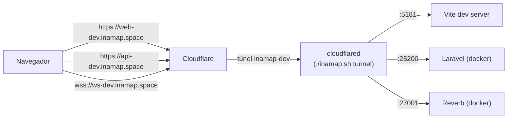

# INAMAP frontend — modos local y túnel

Las tres apps pueden correr de dos formas contra el mismo backend
([`inamap-backend-docker`](../inamap-backend-docker/QUICK_COMMANDS.md)):

| Modo | Para qué | Frontend | Backend |
|---|---|---|---|
| **local** | Desarrollo diario, sin internet ni Cloudflare | `http://localhost:518x` | `http://localhost:25200` |
| **tunnel** | Compartir, probar desde otro dispositivo, OAuth/webhooks | `https://*-dev.inamap.space` | `https://api-dev.inamap.space` + `wss://ws-dev.inamap.space` |

| App | Puerto | Hostname público |
|---|---|---|
| `inamap-app` (visor público) | 5180 | `app-dev.inamap.space` |
| `inamap-web` (panel de clientes) | 5181 | `web-dev.inamap.space` |
| `inamap-system` (plataforma) | 5182 | `system-dev.inamap.space` |

## Comandos

```bash
# Local (sin túnel)
pnpm dev:all                    # las tres apps
pnpm dev:app | dev:web | dev:system

# Túnel
pnpm tunnel:init                # una vez: crea los env de modo túnel
pnpm tunnel:routes              # agrega las 3 rutas + DNS al túnel (idempotente)
pnpm dev:tunnel:all             # tunnel:routes + las tres apps en modo túnel
pnpm dev:app:tunnel | dev:web:tunnel | dev:system:tunnel
```

Local y túnel usan los mismos puertos: corra uno u otro, no ambos a la vez.

## Cómo funciona



- **Un solo túnel, un solo conector.** Las rutas de las apps se agregan al túnel `inamap-dev` del
  backend. `cloudflared` lo corre `./inamap.sh tunnel` (o `up --tunnel`) en `inamap-backend-docker`;
  `pnpm tunnel:routes` solo escribe ingress y CNAME vía API y el conector las toma en vivo. No hay
  un segundo daemon.
- **Credenciales:** `scripts/inamap-tunnel.mjs` las lee de `../inamap-backend-docker/.env.tunnel`
  (`CF_API_TOKEN`, `CF_ACCOUNT_ID`, zona y nombre del túnel). Para otra ubicación: `INAMAP_TUNNEL_ENV=/ruta/.env.tunnel`.
- **Env por app** (no van a git; los genera `pnpm tunnel:init` copiando los `.local`):

  | App | Local | Túnel |
  |---|---|---|
  | `inamap-web` | `.env.inamap-web.local` | `.env.inamap-web.tunnel` |
  | `inamap-system` | `.env.inamap-system.local` | `.env.inamap-system.tunnel` |
  | `inamap-app` | `.env.local` | `.env.tunnel` (`vite --mode tunnel`) |

  El modo túnel solo cambia URLs: `VITE_APP_FRONTEND_URL`, `VITE_APP_BACKEND_URL`,
  `VITE_APP_ADMIN_API_URL`, `VITE_APP_INAMAP_APP_URL`, `VITE_HMR_HOST` y el websocket
  (`ws-dev.inamap.space`, puerto 443, `https`). La clave `VITE_APP_SOCKETS_KEY` es la misma.
  Si el backend cambia la clave de Reverb, actualícela en los `.tunnel` (o borre y regenere).

## Lo que hace falta del lado del backend

1. Backend en modo túnel: `./inamap.sh up --tunnel` (monta `.env.app.tunnel`, con `FRONTEND_URL`
   y `INAMAP_APP_URL` apuntando a `web-dev` y `app-dev`).
2. CORS: la capa `domain-config-layers/20-inamap-tunnel/cors.php` del backend permite los tres
   orígenes `https://*-dev.inamap.space`; la capa `10-inamap-local` permite `localhost:5180-5182`.
   Un hostname nuevo necesita su origen en una de esas capas y `./inamap.sh restart`.

## Vite detrás del túnel (por qué hay cambios en `vite.config`)

- **`allowedHosts`:** Vite rechaza cualquier `Host` que no esté en la lista (protección contra DNS
  rebinding) y Cloudflare lo muestra como un 502/conexión rota aunque el túnel esté sano. Las
  configs de `inamap-web` / `inamap-system` agregan el hostname de `VITE_APP_FRONTEND_URL`;
  `inamap-app` usa `VITE_PUBLIC_HOST`.
- **HMR:** el navegador entra por https, así que el HMR no puede ir por `ws://localhost:528x`.
  Si `VITE_HMR_HOST` es un hostname público, el HMR usa `wss` por el puerto 443 compartiendo el
  puerto del dev server (el túnel solo enruta ese puerto). Con `localhost` el comportamiento es el
  de siempre (`ws://localhost:5281/hmr/`).

## Agregar otra app o hostname

1. Agregue la entrada en `APPS` de `scripts/inamap-tunnel.mjs` (hostname + puerto) y, si tiene env
   propia, en `init`.
2. Origen CORS en `inamap-backend-docker/domain-config-layers/20-inamap-tunnel/cors.php`.
3. `pnpm tunnel:routes`.

## Problemas frecuentes

| Síntoma | Causa / solución |
|---|---|
| `https://web-dev.inamap.space` da **530** | El conector no corre: `./inamap.sh tunnel` en `inamap-backend-docker`. |
| Da **502** o "Blocked request. This host is not allowed" | Vite no acepta el Host: ¿corre en modo túnel (`dev:web:tunnel`) y existe el `.env.*.tunnel` con `VITE_APP_FRONTEND_URL`? |
| La app carga pero las llamadas a la API fallan por CORS | Origen faltante en `20-inamap-tunnel/cors.php`; `./inamap.sh restart` en el backend. |
| Los websockets no conectan | Backend sin `--tunnel` (`REVERB_HOST` local), o `VITE_APP_SOCKETS_KEY` distinta de `REVERB_APP_KEY`. |
| HMR no recarga en la página pública | Revise en la consola del navegador que conecte a `wss://<host>/hmr/`; reinicie el dev server tras cambiar el env. |
| `tunnel:routes` falla con "No existe el túnel" | Primero `./inamap.sh up --tunnel` en el backend (crea `inamap-dev`). Un túnel nuevo tarda hasta ~10 min en aceptar conexiones. |
| Funciona en local y no en túnel | Los `.tunnel` se generan una sola vez; si cambió el `.local`, borre el `.tunnel` y `pnpm tunnel:init`. |
